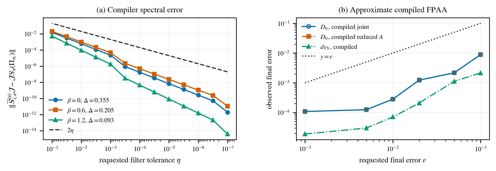

# Ancilla-Efficient QSample Preparation

[](https://github.com/nicholaszhao-19/ancilla-efficient-qsample/actions/workflows/validation.yml)

Reproducible numerical experiments for **Ancilla-Efficient QSAMPLE Preparation for Reversible Markov Chains**, by Nicholas Zhao. Accepted at **IEEE QCE 2026, QALG track**.

[Read the paper on arXiv](https://arxiv.org/abs/2605.23442) · [Mathematical specification](qsample-validation/SPEC.md) · [Validation report](qsample-validation/REPORT.md)

## Experiment at a glance

An exactly enumerated **2 × 4 open Ising ladder** (8 spins, 256 configurations, 10 edges) is cooled through inverse temperatures **0, 0.3, 0.6, 0.9, 1.2**. Lazy random-scan heat-bath chains supply the reversible Markov dynamics. The implementation transports a coherent Gibbs sample through four fixed-point amplitude-amplification stages using approximate selective-phase operators.

The energy is the number of disagreeing neighbouring spins. This corresponds to conventional Ising coupling **J = 1/2**, up to an additive constant.

**Scope:** this is a deterministic, double-precision **spectral reference simulation**, with a documented canonical unitary completion. It evaluates the intended GQSP filter on the walk spectrum and propagates the full state. It does **not** synthesize GQSP rotation angles or execute a gate-level circuit or quantum-hardware experiment. The paper's one working-ancilla result is a theoretical resource statement; the simulation also represents the system and transition registers.

## Recorded results

For requested final error **ε = 10⁻³**, the saved phase-weighted benchmark records:

| Quantity | Value |
|---|---:|
| Joint pure-state trace distance | 1.08168 × 10⁻⁴ |
| Reduced-system trace distance | 1.08168 × 10⁻⁴ |
| Measurement total variation distance | 1.88880 × 10⁻⁵ |
| Clean-subspace leakage | 1.17669 × 10⁻¹⁶ |
| Controlled-walk calls | 10,516 |
| Total transition-oracle calls | 21,064 |

These are numerical reference results, not wall-clock speedups or hardware measurements. Ideal-projector values are separately labelled diagnostic controls.



Inspect the [CSV results](qsample-validation/outputs/data/) and [independent audit](qsample-validation/outputs/data/publication_audit.json). Files prefixed `corrected_` report the alternative uniform filter allocation; see the implementation and specification for the distinction. The table above refers to `end_to_end_sweep.csv`, not a mixture of the two allocations.

## Quick start

Use **Python 3.12** for the pinned dependencies. From the repository root:

```bash
python3.12 -m venv .venv
source .venv/bin/activate
python -m pip install -e "./qsample-validation[test]" -c qsample-validation/requirements-repro.txt
cd qsample-validation
python -W error -m pytest
python -m ruff check .
```

### Reproduce the numerical results

From `qsample-validation/`:

```bash
export PYTHONPATH=src
export MPLCONFIGDIR=/tmp/qsample-mpl
python scripts/run_benchmark.py
python scripts/run_compiler_sweep.py
python scripts/run_end_to_end_sweep.py
python scripts/make_paper_outputs.py
```

### Paper and publication build

Read the paper on [arXiv](https://arxiv.org/abs/2605.23442). The manuscript PDF and LaTeX source are not distributed in this repository.

The publication build (`scripts/build_publication.py`) and full publication audit (`scripts/run_publication_audit.py`) require local copies of `SAMPLE_Final.tex` and `SAMPLE_Final.pdf` in the repository root. The saved audit records the earlier complete publication build; it includes hashes of those manuscript files. The numerical reproduction commands above do not require them.

## Repository guide

- `qsample-validation/src/`: Ising model, reversible chains, Szegedy walk, filter, selective-phase compiler, FPAA and metrics.
- `qsample-validation/tests/`: mathematical invariants and production-path regression tests.
- `qsample-validation/configs/ising_2x4.yaml`: complete frozen benchmark parameters.
- `qsample-validation/scripts/`: reproduction and independent audit entry points.
- `qsample-validation/outputs/`: inspectable CSV data, plots and audit record.
- `qsample-validation/paper/`: figure sources and generated table.

## Citation

```bibtex
@misc{zhao2026ancilla,
  title = {Ancilla-Efficient QSAMPLE Preparation for Reversible Markov Chains},
  author = {Nicholas Zhao},
  year = {2026},
  eprint = {2605.23442},
  archivePrefix = {arXiv},
  primaryClass = {quant-ph},
  doi = {10.48550/arXiv.2605.23442}
}
```

## Attribution and reuse

Code and manuscript by Nicholas Zhao. This release does not grant an additional reuse licence for the original research material; contact the author for reuse permission. Bundled `quantikz.sty` and `tikzlibraryquantikz.code.tex` retain Alastair Kay's CC BY 4.0 notices. `IEEEtran.cls` retains its original LaTeX Project Public License notice. These third-party files are used for typesetting and are not original research contributions.
